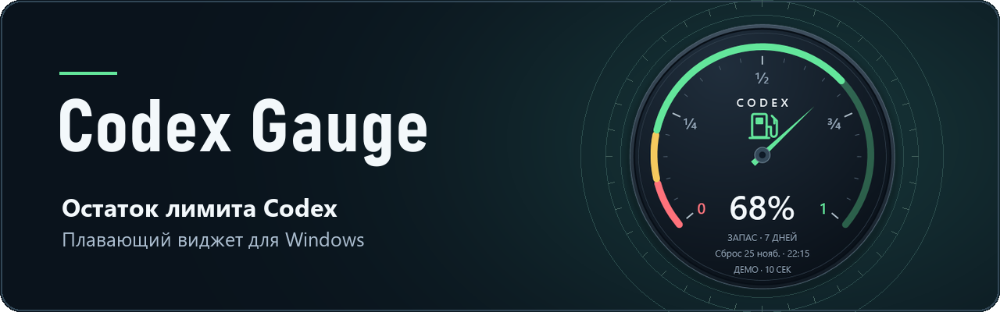
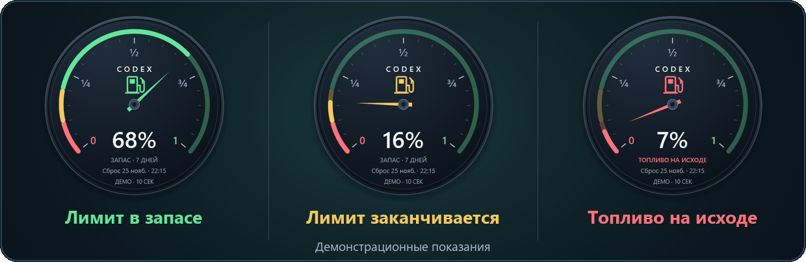
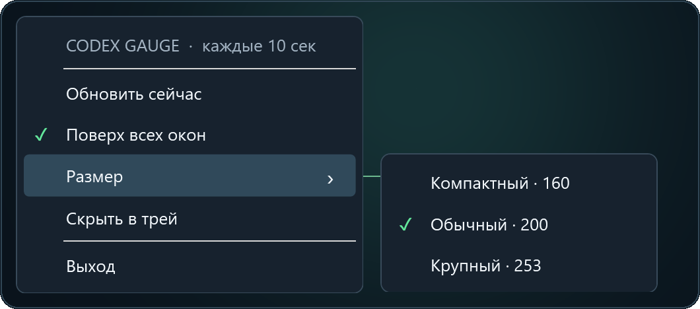

<h1 align="center">
  
</h1>

<div align="center">
  <p>Плавающий виджет для Windows показывает, сколько лимита Codex осталось и когда он обновится.</p>
  
  
  <a href="LICENSE"></a>
  <p><a href="#быстрый-запуск">Быстрый запуск</a> · <a href="#как-читать-шкалу">Шкала</a> · <a href="#управление">Управление</a> · <a href="#если-что-то-не-работает">Помощь</a></p>
</div>

## Быстрый запуск

**Через установщик.** Запустите `CodexGauge-Setup-x64.exe` на Windows 10 или 11 x64 и откройте **Codex Gauge** в меню «Пуск». Мастер устанавливает виджет в `%LOCALAPPDATA%\Programs\CodexGauge` для текущего пользователя. .NET входит в комплект. Права администратора и интернет для самой установки не нужны. Для чтения лимитов нужен установленный Codex со входом через ChatGPT.

Перед обновлением или удалением закройте виджет через **«Выход»** в трее. Удалить его можно через список установленных приложений Windows. Настройки виджета сохраняются.

Установщик собирается в `dist\CodexGauge-Setup-x64.exe`. Готового файла в GitHub Releases пока нет.

<details>
<summary>Собрать установщик из исходников</summary>

Понадобятся [.NET 8 SDK](https://dotnet.microsoft.com/download/dotnet/8.0) и [NSIS 3](https://nsis.sourceforge.io/Download). Клонируйте репозиторий и выполните в PowerShell.

```powershell
git clone https://github.com/Mikhail-068/Codex-Limit.git
Set-Location Codex-Limit
.\installer\Build-Setup.ps1
```

Если используете переносимый NSIS, укажите путь к компилятору. После сборки скрипт выведет SHA-256 установщика.

```powershell
.\installer\Build-Setup.ps1 -MakeNsis 'C:\Tools\NSIS\makensis.exe'
```

</details>

<details>
<summary>Собрать и запустить виджет напрямую</summary>

После клонирования репозитория или распаковки архива **Code → Download ZIP** откройте PowerShell в папке исходников. Для сборки нужен .NET 8 SDK.

```powershell
dotnet publish .\src\CodexGauge\CodexGauge.csproj -c Release `
  -o .\dist\CodexGauge --self-contained false

.\dist\CodexGauge\CodexGauge.exe
```

> [!TIP]
> Для переноса этой сборки на другой ПК скопируйте целиком папку `dist\CodexGauge`. На новом ПК понадобятся **.NET 8 Desktop Runtime** под его архитектуру и Codex с выполненным входом.

</details>

## Как читать шкалу

Стрелка показывает **остаток** выбранного лимита. На 100% лимит доступен полностью. На 0% он исчерпан. По умолчанию виджет показывает недельное окно Codex. Другие доступные периоды и модели выбираются правым кликом.

<p align="center">
  
</p>

| Остаток | Цвет шкалы |
| --- | --- |
| Выше 20% | Зелёный |
| От 10% до 20% включительно | Жёлтый |
| Ниже 10% | Красный. При свежем показании виджет пишет «Топливо на исходе» |

> [!NOTE]
> Виджет запрашивает снимок лимитов каждые 10 секунд и реагирует на уведомления Codex. Если данные устарели, шкала тускнеет. При неизвестном остатке прибор показывает прочерк.

## Управление

<p align="center">
  
</p>

| Действие | Результат |
| --- | --- |
| Перетащить прибор левой кнопкой | Переместить по рабочему столу |
| Нажать правой кнопкой | Выбрать лимит, размер и режим поверх окон |
| Дважды нажать на прибор | Переключить компактный и обычный размеры |
| Нажать `F5` или выбрать **«Обновить сейчас»** | Запросить свежий снимок лимитов |
| Нажать `Esc` | Скрыть виджет. Двойной щелчок по бензоколонке в трее вернёт его |

Виджет сохраняет положение, размер и выбранный лимит. Автозапуск можно настроить в Windows отдельно.

## Если что-то не работает

| Ситуация | Что сделать |
| --- | --- |
| **«Нужен вход»** | Откройте меню виджета, выберите **«Войти в Codex…»** и завершите вход через ChatGPT в браузере. Лимиты подписки доступны при входе через ChatGPT. |
| **«Codex не найден»** | Запустите настольный Codex или задайте путь к `codex.exe` по инструкции ниже. |
| **«Нет связи с Codex»** | Проверьте интернет и работу Codex. Затем выберите **«Обновить сейчас»** или дождитесь следующей проверки. |
| **Виджет скрылся** | Дважды нажмите на бензоколонку в трее. Значок может находиться в списке скрытых значков. |
| **Windows просит установить .NET** | Для прямого запуска установите [.NET 8 Desktop Runtime](https://dotnet.microsoft.com/download/dotnet/8.0) под архитектуру сборки. Мастер установки включает собственную .NET. |

<details>
<summary>Ручной путь к Codex и сброс настроек</summary>

Обычно виджет находит Codex автоматически. Для нестандартной установки закройте виджет через **«Выход»**, укажите полный путь к исполняемому файлу и запустите виджет заново.

```powershell
$env:CODEX_GAUGE_CODEX_PATH = 'C:\Tools\Codex\codex.exe'
.\dist\CodexGauge\CodexGauge.exe
```

Настройка действует в текущем сеансе PowerShell. Для постоянной настройки добавьте `CODEX_GAUGE_CODEX_PATH` в переменные среды пользователя Windows. Чтобы сбросить положение и размер, закройте виджет и переименуйте `%LOCALAPPDATA%\CodexGauge\settings.json`.

</details>

## Как это работает

WPF-виджет получает снимки лимитов через [Codex App Server](https://learn.chatgpt.com/docs/app-server) и рассчитывает остаток по данным сервиса. Опрос лимитов не запускает запросы к модели. Авторизацией управляет Codex, виджет хранит локально настройки интерфейса и выбранный лимит. Подробнее в [описании архитектуры](docs/architecture/README.md) и [результатах проверок](docs/verification.md).

<details>
<summary>Команды локальной проверки</summary>

После сборки запустите встроенный тест и отрисовку циферблата с демонстрационным значением. Эти команды работают без аккаунта и сети.

```powershell
New-Item -ItemType Directory -Force .\artifacts | Out-Null
.\dist\CodexGauge\CodexGauge.exe --self-test "$PWD\artifacts\self-test.json" | Out-Null
Get-Content .\artifacts\self-test.json
.\dist\CodexGauge\CodexGauge.exe --render "$PWD\artifacts\preview.png" 68 | Out-Null
```

</details>

## Лицензия

Авторский код распространяется по [лицензии MIT](LICENSE). Codex Gauge — независимый проект. Названия Codex и ChatGPT используются для обозначения совместимых продуктов OpenAI. Автор проекта — [Mikhail-068](https://github.com/Mikhail-068).
